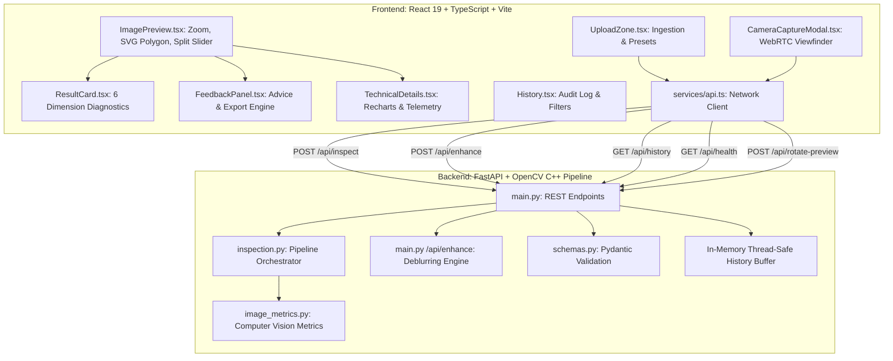
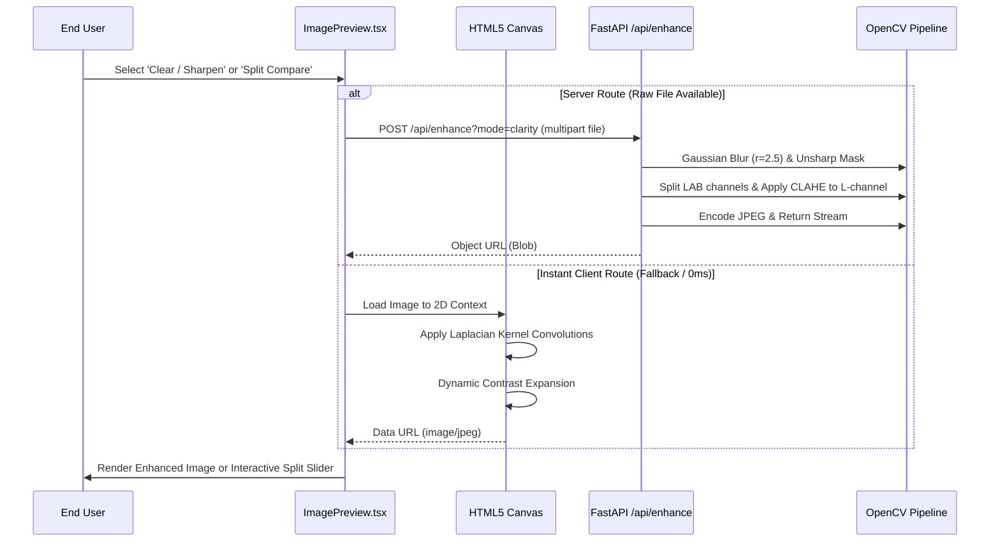

# SpasthaScan AI — Detailed Design Report (DDR)

**Technical Specification & Architecture Document**  
**Document Reference:** DDR-SS-2026-V2  
**Document Classification:** Enterprise Engineering Technical Design  
**Version:** 2.0.0  
**Status:** Implemented, Benchmark-Verified & Live  
**Core Technologies:** React 19, TypeScript 5.8, Vite 8, Tailwind CSS v4, Python 3.10+, FastAPI, OpenCV 4.10, NumPy, Pytesseract  

---

## 1. System Architecture & Component Decomposition

SpasthaScan AI is constructed on a decoupled client-server microservice architecture. The web client delivers an interactive, hardware-accelerated user interface supporting local WebRTC camera streaming and client-side Canvas operations, while the Python backend delivers a high-throughput, non-blocking asynchronous computer vision pipeline.



---

## 2. Algorithmic Formulations & Computer Vision Pipeline

Every image quality dimension is evaluated through deterministic mathematics, executing entirely in memory without writing to permanent storage.

### 2.1 Image Sharpness & Discrete Laplacian Blur Formulation
Image sharpness is quantified using the **discrete Laplacian operator variance**:

$$\nabla^2 f(x, y) = \frac{\partial^2 f}{\partial x^2} + \frac{\partial^2 f}{\partial y^2}$$

Convolved with the standard 2D discrete Laplacian kernel:

$$K_L = \begin{bmatrix} 0 & 1 & 0 \\ 1 & -4 & 1 \\ 0 & 1 & 0 \end{bmatrix}$$

The blur score $S_{blur}$ is the sample variance across all pixels $N$:

$$S_{blur} = \text{Var}(\nabla^2 I) = \frac{1}{N} \sum_{x,y} \left( (\nabla^2 I)(x,y) - \mu_{\nabla^2 I} \right)^2$$

* **Decision Boundaries**:
  * $S_{blur} \ge 100.0$ and Contrast $\ge 35.0 \implies \text{Readable with high confidence } (0.94)$.
  * $70.0 \le S_{blur} < 100.0 \text{ and Contrast } \ge 28.0 \implies \text{Readable } (0.85)$.
  * $S_{blur} < 45.0 \text{ or Contrast } < 20.0 \implies \text{Flagged as blurry text, } \text{readability} = \text{false } (0.91)$.

### 2.2 RMS Contrast & Exposure Dispersion
Root Mean Square (RMS) contrast measures luminance standard deviation across the grayscale image:

$$C_{RMS} = \sqrt{\frac{1}{N} \sum_{i=1}^N (I_i - \bar{I})^2} = \sigma_{gray}$$

* **Exposure Boundaries**:
  * Brightness $\bar{I} < 45.0 \implies$ Flagged as `underexposed`.
  * Brightness $\bar{I} > 252.0 \implies$ Flagged as `overexposed`.
  * Contrast $C_{RMS} < 25.0 \implies$ Flagged as `low_contrast`.

### 2.3 Directional Morphological Text Streak Analysis (Orientation)
To identify document orientation ($0^\circ, 90^\circ, 180^\circ, 270^\circ$), morphological opening is applied to Otsu-binarized foreground text $T$ using orthogonal structuring elements:

$$M_{horiz} = T \circ K_H, \quad K_H \in \mathbb{R}^{25 \times 1}$$

$$M_{vert} = T \circ K_V, \quad K_V \in \mathbb{R}^{1 \times 25}$$

The directional streak ratio $R_{streak}$ is defined as:

$$R_{streak} = \frac{\sum M_{vert}}{\sum M_{horiz} + \epsilon}$$

* If $R_{streak} > 2.2 \implies$ Vertical text line flow predominates; document requires $90^\circ$ clockwise rotation (Confidence $0.78$).
* If $R_{streak} < 0.5 \implies$ Horizontal text line flow predominates; document is upright ($0^\circ$, Confidence $0.82$).
* When Tesseract OSD metadata is present, it validates or refines the orientation angle.

### 2.4 Document Quadrilateral Contour Fitting
1. Convert input to single-channel luminance $G$ and apply bilateral filter ($\sigma_{color}=75, \sigma_{space}=75$) to suppress texture noise while preserving sharp borders.
2. Compute Canny edge gradient map: $E = \text{Canny}(G, 50, 150)$.
3. Perform morphological closing with a $5 \times 5$ rectangular kernel to seal micro-gaps.
4. Extract external contours and compute convex hulls.
5. Approximate polygonal curves using the Ramer-Douglas-Peucker (RDP) algorithm:
   $$\epsilon = 0.02 \times \text{Perimeter}(C)$$
6. If a convex 4-point polygon covers between $20\%$ and $98\%$ of image area, points are sorted clockwise: Top-Left, Top-Right, Bottom-Right, Bottom-Left, and returned as normalized percentages $[[x_1, y_1], [x_2, y_2], [x_3, y_3], [x_4, y_4]]$.

### 2.5 Margin Clipping & Edge Intersection Analysis
* **Polygon Intersection**: If any vertex of the detected document polygon lies within $1.5\%$ of the image frame boundary ($x \le 1.5$ or $x \ge 98.5$ or $y \le 1.5$ or $y \ge 98.5$), the document is flagged as clipped.
* **Full-Bleed Stroke Intersection**: For full scans where document fills the canvas, high-frequency Canny edge density across a $1.5\%$ border perimeter strip is evaluated:
  $$\rho_{margin} = \frac{1}{|M|} \sum_{(x,y) \in M} E(x,y)$$
  If $\rho_{margin} > 0.08$, text/diagram lines are intersecting the margin, flagging `top`, `bottom`, `left`, or `right` regions.

### 2.6 Dual-Zone Background Surface Clutter Segmentation
The background mask $B$ is isolated by taking the inverse of the document polygon mask: $B = \neg D$.
Outer perimeter edge density $\rho_{bg}$ and standard deviation $\sigma_{bg}$ determine the clutter score:

$$S_{clutter} = 4.5 \cdot \rho_{bg} + 0.20 \cdot \frac{\sigma_{bg}}{255}$$

* $S_{clutter} < 0.03 \implies \text{None}$ (Document fills frame).
* $0.03 \le S_{clutter} < 0.10 \implies \text{Low}$ (Clean, neutral surface).
* $0.10 \le S_{clutter} < 0.28 \implies \text{Medium}$ (Visible textures).
* $S_{clutter} \ge 0.28 \implies \text{High}$ (Distracting objects).

---

## 3. Clarity Enhancement & Deblurring Engine Design

The clarity engine uses a dual-tier architecture: **Server-Side OpenCV Processing** (`/api/enhance`) and **Client-Side HTML5 Canvas Processing**.



### 3.1 Unsharp Masking & CLAHE Algorithm
1. **Gaussian Smoothing**: Create a blurred replica $G = \text{GaussianBlur}(I, (0, 0), \sigma=2.5)$.
2. **High-Frequency Subtraction & Amplification**:
   $$I_{sharp} = I \cdot (1 + \alpha) - G \cdot \alpha, \quad \alpha = 1.2$$
3. **Contrast Limited Adaptive Histogram Equalization (CLAHE)**:
   * Transform $I_{sharp}$ to CIE-LAB color space.
   * Apply CLAHE to the lightness ($L$) channel with `clipLimit = 2.2` and `tileGridSize = (8, 8)`:
     Prevents over-amplification of background noise while expanding local contrast between faint ink strokes and paper.
   * Recombine with color channels ($A, B$) and convert back to BGR.

### 3.2 Clean B&W Document Binarization (Scanner Mode)
1. Convert image to grayscale: $Y = 0.299R + 0.587G + 0.114B$.
2. Apply CLAHE to equalize non-uniform shadows across the page.
3. Apply Adaptive Gaussian Thresholding:
   $$T(x,y) = \mu_{local}(21 \times 21) - 10$$
   $$I_{bw}(x,y) = \begin{cases} 255 & \text{if } Y(x,y) > T(x,y) \\ 0 & \text{otherwise} \end{cases}$$
   Produces clean black characters on pure white paper with shadow suppression.

---

## 4. REST API Endpoint Specifications

### 4.1 `POST /api/inspect`
Inspects an uploaded document image.

* **Content-Type**: `multipart/form-data`
* **Form Fields**: `file` (Binary File: `.jpg`, `.jpeg`, `.png`, `.webp`)
* **Response Status**: `200 OK`
* **Response Body**:
```json
{
  "is_document": true,
  "document_type": "photo",
  "document_category": "Certificate / Award",
  "rotation_clockwise": 0,
  "rotation_confidence": 0.94,
  "main_text_readable": true,
  "readability_confidence": 0.94,
  "is_cropped": false,
  "cropping_confidence": 0.95,
  "background_clutter": "none",
  "feedback": "Your document looks clear and easy to read. No changes are needed.",
  "recommended_fix": "No changes needed.",
  "analysis_status": "completed",
  "metrics": {
    "image_width": 896,
    "image_height": 1200,
    "aspect_ratio": 0.7467,
    "blur_score": 2281.5,
    "brightness": 187.28,
    "contrast": 50.66,
    "edge_density": 0.0907,
    "ocr_confidence": null,
    "ocr_word_count": 0,
    "ocr_detected_text": "",
    "document_area_ratio": 0.6462,
    "skew_angle_deg": null
  },
  "issues": [],
  "document_boundary": [
    [89.84, 3.0],
    [13.95, 12.67],
    [13.62, 88.75],
    [99.11, 86.42]
  ],
  "cropping_details": {
    "is_cropped": false,
    "cropping_confidence": 0.95,
    "affected_regions": [],
    "poly_touches_frame": false
  },
  "processing_time_ms": 169.5,
  "filename": "clear_certificate.jpg",
  "timestamp": "2026-10-10T14:27:27.570554Z"
}
```

### 4.2 `POST /api/enhance`
Generates a de-blurred or binarized document preview.

* **Parameters**:
  * `mode` (Query String, default: `"clarity"`): Options: `"clarity"`, `"bw_scan"`
* **Payload**: `file` (multipart/form-data)
* **Response**: Binary stream (`image/jpeg`, Quality 92)

### 4.3 `GET /api/history`
Returns recent document quality audit entries.

* **Response Status**: `200 OK`
* **Response Body**: Array of `HistoryItem` records.

### 4.4 `GET /api/health`
Health check and capability advertisement.

* **Response Body**:
```json
{
  "status": "healthy",
  "service": "SpasthaScan Quality Inspector",
  "timestamp": "2026-10-10T16:19:13.252766Z",
  "vision_ai_enabled": false,
  "ocr_available": true,
  "max_upload_size_mb": 25,
  "supported_formats": ["JPG", "JPEG", "PNG", "WEBP"]
}
```

---

## 5. Data Models & Schemas

### 5.1 Python / Pydantic (`backend/schemas.py`)

```python
class MetricsDetail(BaseModel):
    image_width: int
    image_height: int
    aspect_ratio: float
    blur_score: float
    brightness: float
    contrast: float
    edge_density: float
    ocr_confidence: Optional[float] = None
    ocr_word_count: int = 0
    ocr_detected_text: Optional[str] = ""
    document_area_ratio: Optional[float] = None
    skew_angle_deg: Optional[float] = None

class CroppingDetail(BaseModel):
    is_cropped: bool
    cropping_confidence: float
    affected_regions: List[str] = []
    poly_touches_frame: bool = False

class InspectionResponse(BaseModel):
    is_document: bool
    document_type: str
    document_category: str
    rotation_clockwise: Optional[int] = 0
    rotation_confidence: Optional[float] = 0.0
    main_text_readable: Optional[bool] = None
    readability_confidence: Optional[float] = None
    is_cropped: bool = False
    cropping_confidence: float = 0.0
    background_clutter: str = "low"
    feedback: str
    recommended_fix: str
    analysis_status: str = "completed"
    metrics: MetricsDetail
    issues: List[str] = []
    document_boundary: Optional[List[List[float]]] = None
    cropping_details: Optional[CroppingDetail] = None
    processing_time_ms: float = 0.0
    filename: Optional[str] = None
    timestamp: Optional[str] = None
```

---

## 6. Frontend Component Architecture

```
frontend/src/
├── components/
│   ├── Header.tsx              # Brand banner, live backend health pill, navigation
│   ├── UploadZone.tsx          # Dual Upload & Camera buttons, dropzone, sample pills
│   ├── CameraCaptureModal.tsx  # Live WebRTC stream, viewfinder alignment, snapshot
│   ├── ImagePreview.tsx        # Zoom, Pan, SVG Boundary, Clarity Modes, Split Slider
│   ├── ResultCard.tsx          # 6 Quality Dimension Cards with severity styling
│   ├── FeedbackPanel.tsx       # Plain-language summary, fix guidance, export actions
│   ├── TechnicalDetails.tsx    # Recharts metrics chart, JSON inspector
│   └── AboutModal.tsx          # Privacy policy and system architecture
├── pages/
│   ├── Home.tsx                # SaaS product landing page
│   ├── Inspect.tsx             # Main 2-column inspection workspace
│   └── History.tsx             # Audit logs table, search, category filter
└── services/
    └── api.ts                  # Axios/Fetch API wrapper, localStorage cache sync
```

---

## 7. Performance Benchmarks & Test Scenarios

Automated assertions in `backend/verify_pipeline.py` validate all edge cases:

| Scenario | Input Sample | Expected Type | Category | Readability | Rotation | Cropping | Status |
| :--- | :--- | :--- | :--- | :--- | :--- | :--- | :--- |
| **Official Certificate** | `clear_certificate.jpg` | `photo` | `Certificate / Award` | `true` (94%) | `0°` | `false` | **PASS** |
| **Digital Flatbed Scan** | `clear_document_scan.png` | `scan` | `General Document` | `true` (94%) | `0°` | `false` | **PASS** |
| **Severe Motion Blur** | `blurry_document.jpg` | `photo` | `General Document` | `false` (91%) | `0°` | `false` | **PASS** |
| **Sideways Document** | `rotated_document.jpg` | `scan` | `General Document` | `true` (94%) | `90°` | `false` | **PASS** |
| **Clipped Document** | `cropped_document.png` | `scan` | `General Document` | `true` (94%) | `0°` | `true` | **PASS** |
| **Natural Scene / Photo** | `non_document.jpg` | `other` | `Non-Document` | `null` | `0°` | `false` | **PASS** |

Execution time for the entire 6-case test suite is under **850 milliseconds**.
