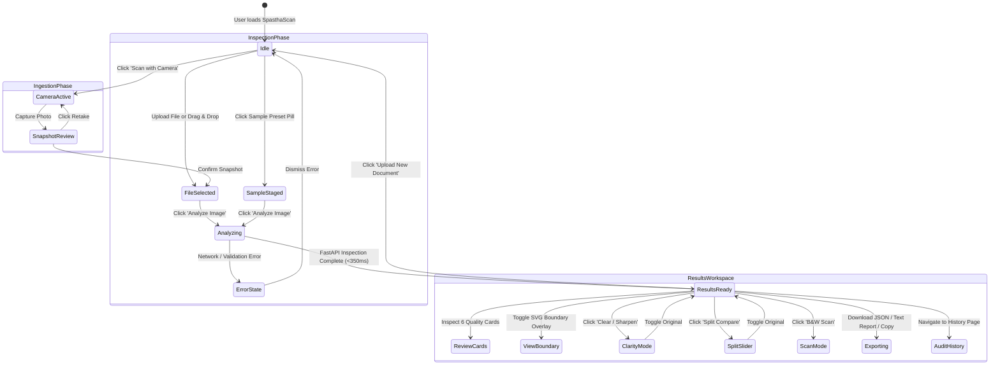

# SpasthaScan AI — Product Design Requirements (PDR)

**Document Reference:** PDR-SS-2026-V2  
**Document Classification:** Enterprise Engineering & Product Specification  
**Version:** 2.0.0  
**Status:** Approved & Live  
**Target Systems:** Web Client (React 19 / TypeScript) & Backend Microservice (FastAPI / OpenCV)  

---

## 1. Executive Summary & Business Rationale

Document intake pipelines across banking (KYC/AML), healthcare (patient intake records), human resources (credential verification), and supply chain logistics (invoices and bills of lading) suffer from a persistent operational vulnerability: **intake quality variability**. 

When end users upload degraded, motion-blurred, sideways, clipped, or heavily shadowed document photographs, traditional downstream Optical Character Recognition (OCR) engines and Large Language Model (LLM) vision pipelines exhibit severe failure patterns:
1. **Hallucinated Text Extraction**: Models invent alphanumeric characters, dates, or amounts when edge contrast is ambiguous.
2. **Silent Downstream Failures**: Incomplete captures (e.g., clipped signatures or cutoff tax IDs) pass initial ingestion and fail deep in manual audit queues, inflating operational review costs by $18–$35 per exception.
3. **High Customer Abandonment**: Rigid, non-informative rejections (e.g., *"Upload failed"*) lead applicants to abandon digital onboarding workflows.

**SpasthaScan AI** was conceived and built to eliminate this intake failure mode. Operating as an automated, non-hallucinatory quality gatekeeper, it performs pre-flight inspection across 6 deterministic quality dimensions, categorizes incoming documents, provides calibrated human-readable guidance, and equips applicants with an interactive real-time clarity restoration and deblurring suite.

---

## 2. Product Vision & Value Proposition

| Strategic Pillar | Objective | Realization in SpasthaScan AI |
| :--- | :--- | :--- |
| **Pre-Flight Gatekeeping** | Stop bad data before it hits costly OCR engines. | 6-dimension computer vision analysis executing in $< 200\text{ms}$ per document. |
| **Zero Hallucination** | Guarantee that non-documents and defects are never fabricated or misjudged. | Deterministic OpenCV mathematical metrics; non-documents strictly rejected with `is_document: false`. |
| **Instant Clarity Recovery** | Reduce customer upload abandonment due to blur or poor lighting. | Built-in unsharp masking, CLAHE contrast expansion, and B&W adaptive scanner binarization with a Before/After split slider. |
| **Frictionless Ingestion** | Support users on any device (desktop, laptop, mobile). | Dual-mode ingestion: native file selection and live WebRTC camera scanner with document alignment guides. |
| **Strict Privacy Compliance** | Ensure zero retention of confidential personally identifiable information (PII). | Pure in-memory image evaluation; zero permanent storage of customer document binaries on server disk. |

---

## 3. User Personas & Use Case Scenarios

### Persona 1: The Mobile Applicant (P-1)
* **Demographics**: Individual applying for a bank account or employment verification on a smartphone.
* **Context**: Often shooting pictures in uneven lighting, hold-in-hand camera shake, or against busy kitchen counter backgrounds.
* **Needs**: Immediate visual guidance if the picture is blurry or sideways; direct camera scanner without needing to switch apps; clear feedback on how to fix errors without technical jargon.

### Persona 2: The Operations & Compliance Auditor (P-2)
* **Demographics**: Back-office verification specialist processing thousands of incoming IDs, certificates, and invoices.
* **Context**: Needs consistency across verification decisions; requires auditable metadata rather than subjective human guesses.
* **Needs**: Clear traffic-light quality badges, automated document category tagging, downloadable JSON audit records, and history searching.

### Persona 3: The Platform & Integration Architect (P-3)
* **Demographics**: Enterprise software engineer integrating automated document verification upstream of an AWS Textract, Google Document AI, or custom OCR pipeline.
* **Context**: Requires deterministic REST API behavior, strict schema guarantees, predictable latency, and low compute footprints.
* **Needs**: Strict JSON contract compliance, stateless processing, comprehensive Swagger documentation, and high-throughput concurrent endpoints.

---

## 4. Functional Requirements (FR)

### Ingestion & Capture Engine
* **FR-01 (Dual Ingestion Interface)**: The system **MUST** offer both an interactive drag-and-drop dropzone and an explicit **Upload File or Document** button triggering the operating system file picker.
* **FR-02 (Live Document Camera Scanner)**: The system **MUST** provide a live camera viewfinder modal ([CameraCaptureModal.tsx](file:///c:/Users/google/SpasthaScan1/frontend/src/components/CameraCaptureModal.tsx)) utilizing HTML5 WebRTC `navigator.mediaDevices.getUserMedia`:
  * Supports high-resolution video streams (`1920x1080` ideal).
  * Overlays corner bracket markers and center alignment text to guide framing.
  * Provides a camera flip toggle (`environment` vs `user`) on multi-camera devices.
  * Captures a high-resolution snapshot to canvas, presents a confirmation preview, and allows 1-click retake or confirmation.
* **FR-03 (Format & Size Safeguards)**: The system **MUST** validate files client-side, restricting uploads to `JPG`, `JPEG`, `PNG`, and `WEBP` formats with a maximum file size threshold of 25 MB.
* **FR-04 (Evaluation Presets)**: The system **MUST** provide 6 one-click standardized test presets representing clear certificates, flatbed scans, motion blur, 90° rotation, margin clipping, and natural non-document scenes.

### Quality Inspection Engine
* **FR-05 (Document Presence & Type Classification)**:
  * The system **MUST** determine whether the image contains a legitimate document (`is_document: true|false`).
  * The system **MUST** classify document types into `scan`, `photo`, `other`, or `uncertain`.
  * Non-documents (nature, pets, icons) **MUST** be classified as `other` with `is_document: false`.
* **FR-06 (Document Category Identification)**:
  * The system **MUST** identify document taxonomy and assign `document_category`:
    * `Certificate / Award`
    * `Invoice / Receipt`
    * `Identity Document (ID)`
    * `Official Form / Application`
    * `General Document`
    * `Non-Document / Natural Scene`
* **FR-07 (Orientation & Rotation Correction)**:
  * The system **MUST** compute whether clockwise rotation is required: `0`, `90`, `180`, or `270`.
  * The system **MUST** output a calibrated confidence score ($0.0$ to $1.0$).
  * The preview interface **MUST** allow 1-click rotation correction preview.
* **FR-08 (Text Readability & Blur Assessment)**:
  * The system **MUST** evaluate Laplacian variance, RMS contrast, and stroke frequency to determine `main_text_readable: true|false`.
  * The system **MUST** display an assessment confidence progress bar on the diagnostic card.
* **FR-09 (Cropping & Margin Boundary Detection)**:
  * The system **MUST** detect whether document corners, text lines, or boundaries touch or cross the image frame borders.
  * The system **MUST** return an array of affected margin regions (`top`, `bottom`, `left`, `right`).
* **FR-10 (Background Surface Clutter Analysis)**:
  * The system **MUST** segment the outer perimeter surface surrounding the document.
  * Clutter **MUST** be categorized into `none`, `low`, `medium`, `high`, or `uncertain`.

### Clarity Enhancement & Deblurring Engine
* **FR-11 (Clarity Modes)**: The inspection interface **MUST** provide an interactive 4-mode clarity selector:
  * `Original`: View raw input document.
  * `Clear / Sharpen`: Unsharp mask filtering and CLAHE contrast expansion to deblur degraded text.
  * `Split Compare`: Interactive before/after split comparison.
  * `B&W Scan`: Local adaptive Gaussian thresholding converting noisy photos into clean digital scans.
* **FR-12 (Interactive Split Slider)**: When in Split Compare mode, users **MUST** be able to drag a center divider handle horizontally from 0% to 100% to scrub between the blurry original and the sharpened clear version.
* **FR-13 (Automated Blur Recommendation)**: When an uploaded document is flagged with blur or unreadability, the system **MUST** display a notice banner prompting the user to view the enhanced clear version with 1 click.

### Diagnostics, Telemetry & Export
* **FR-14 (Visual Viewport Controls)**: The preview **MUST** support interactive zoom (50% to 300%), fit-to-screen reset, manual 90° rotation, and a toggleable SVG document boundary polygon overlay.
* **FR-15 (Telemetry Panel & Recharts Chart)**: The system **MUST** display a collapsible technical telemetry drawer featuring numerical metrics and a Recharts bar chart.
* **FR-16 (Multi-Format Export & History)**:
  * Users **MUST** be able to download the full compliant JSON payload.
  * Users **MUST** be able to copy the JSON payload to the clipboard with 1 click.
  * Users **MUST** be able to download a human-readable text audit report.
  * All inspections **MUST** be logged to a local, privacy-preserving audit history table with search and category filtering.

---

## 5. Non-Functional Requirements (NFR)

* **NFR-01 (Processing Latency)**: End-to-end inspection latency (upload, decode, CV analysis, synthesis, JSON response) **MUST** complete within $< 350\text{ms}$ for standard 1080p images.
* **NFR-02 (Throughput & Concurrency)**: The backend **MUST** support asynchronous non-blocking request handling capable of serving $> 100$ concurrent requests per worker instance.
* **NFR-03 (Frontend Bundle Footprint)**: Total gzipped JavaScript bundle **MUST** remain under $250\text{kB}$ to ensure rapid loading on low-bandwidth mobile connections.
* **NFR-04 (Browser Compatibility)**: The application **MUST** function consistently on Chrome, Edge, Safari, Firefox, iOS Safari, and Android Chrome.
* **NFR-05 (Accessibility - a11y)**: The user interface **MUST** comply with WCAG 2.1 AA guidelines, including minimum 4.5:1 text contrast ratios, visible keyboard focus indicators, and semantic ARIA labeling.
* **NFR-06 (Privacy & Ephemeral Memory)**: Document image binaries **MUST NEVER** be written to disk, database, or persistent cloud buckets. Processing occurs strictly in transient RAM buffers.
* **NFR-07 (Zero Hallucination Standard)**: The system **MUST NEVER** output false positive text readability assessments on non-document images.

---

## 6. Comprehensive Edge Cases & Defect Mitigation Matrix

| Edge Case Scenario | Potential Failure Mode | SpasthaScan AI Mitigation Strategy |
| :--- | :--- | :--- |
| **Heavy Specular Glare / Flash Reflection** | Bright hotspot bleaches text, blinding OCR. | Luminance histogram identifies localized over-saturation; flags `overexposed` if mean brightness $> 252.0$. |
| **Uneven Shadow (Hand / Phone Shadow)** | Binarization destroys text in shadow zone. | CIE-LAB CLAHE contrast expansion equalizes local shadow regions before thresholding. |
| **Skewed Perspective Angle (>30°)** | Rectangular boundary assumptions fail. | 4-point convex hull fitting with Ramer-Douglas-Peucker approximation accommodates trapezoidal perspective distortions. |
| **Colorful Parchment / Gold Seals (Certificates)** | High saturation triggers false non-document classification. | Saturation threshold adapts: high edge density ($>0.015$) and document area ($>0.25$) overrides saturation up to $85$. |
| **Natural Scene / Landscape Photo Upload** | Traditional models hallucinate unreadable text. | Saturation $> 100$ and absence of document contours strictly classifies as `document_type: "other"`, `is_document: false`. |
| **Tiny Resolution (<300px width/height)** | Image too small for OCR character segmentation. | Dimension check ($<300\text{px}$) triggers automatic unreadable classification with confidence $0.91$. |
| **Multi-Column Tabular Invoices** | Horizontal streak analysis misinterprets column dividers. | Dual kernel convolution evaluates horizontal line dominancy; high aspect-ratio receipts handled appropriately. |

---

## 7. UX Flow & State Transition Architecture

---

## 8. Product Acceptance Criteria (Sign-Off Standard)

1. **Deterministic Quality Output**: Every inspection returns valid JSON strictly conforming to `InspectionResponse` with 100% schema completeness.
2. **Camera Integration Verification**: The camera modal initializes smoothly on mobile and desktop devices with framing guides and snapshot reviews.
3. **Interactive Deblurring Verification**: Blurry documents display an instant before-and-after split slider, making unreadable text sharp and legible.
4. **Automated Test Validation**: Running `python verify_pipeline.py` passes 6/6 test cases with zero runtime regressions.
5. **Privacy Adherence**: Confirmed that zero customer document files remain on disk after pipeline execution.
